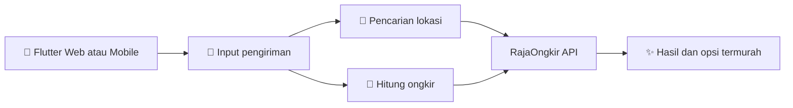
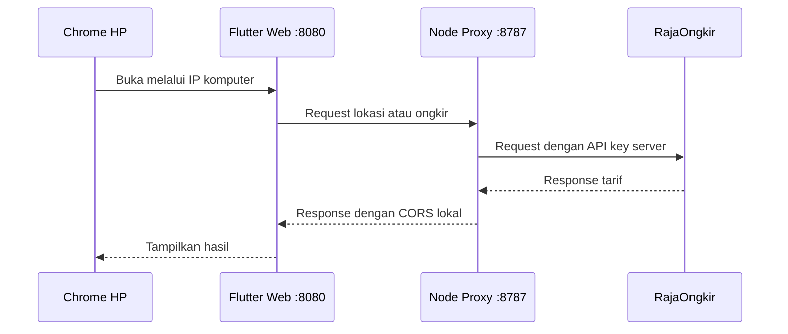
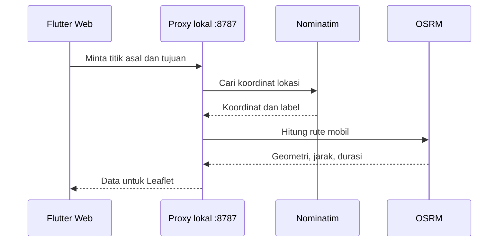

# Ongkirin 📦

Kalkulator ongkos kirim domestik Indonesia berbasis Flutter dan RajaOngkir. Ongkirin membantu pengguna memilih lokasi, memasukkan berat paket, membandingkan kurir, lalu melihat estimasi biaya dan waktu pengiriman dari satu alur yang ringkas.


> 📦 **Ongkirin** membantu membandingkan ongkir, waktu kirim, kurir, dan gambaran rute dalam satu layar yang nyaman dipakai dari HP.

## ✨ Pengalaman utama

| Langkah | Yang dilakukan | Hasil di layar |
| --- | --- | --- |
| 📍 Lokasi | Cari asal dan tujuan atau gunakan lokasi saat ini | Ringkasan rute yang mudah dibaca |
| ⚖️ Paket | Masukkan berat atau gunakan tombol tambah cepat | Berat otomatis tersinkron dengan form |
| 🚚 Kurir | Pilih satu kurir atau bandingkan semua | Layanan tersedia dikumpulkan dalam satu hasil |
| 🧭 Rute | Buka pratinjau Leaflet atau Google Maps | Garis rute, jarak, dan estimasi perjalanan |
| 💡 Pilihan | Gunakan filter semua, termurah, atau tercepat | Kartu hasil diberi konteks yang jelas |


## ✨ Fitur

- Pemilihan asal dan tujuan melalui pencarian lokasi RajaOngkir
- Tombol tukar asal dan tujuan
- Tombol tambah berat `+250 g`, `+500 g`, `+1 kg`, dan `+2 kg`
- Pilihan kurir dan perhitungan estimasi biaya
- Ringkasan pengiriman yang berubah mengikuti input
- Penanda opsi termurah
- Loading, validasi, empty state, timeout, unauthorized, dan server error state
- Proxy Node lokal untuk mengatasi CORS pada Flutter Web
- API key Web disimpan di server proxy, bukan di bundle browser
- Tombol lokasi otomatis dengan fallback pencarian manual
- Rekomendasi tujuan terakhir yang disimpan lokal
- Pratinjau rute Leaflet dan OpenStreetMap di halaman hasil

## 🛣 Alur aplikasi



## ⚙ Arsitektur Web



### Jalur data rute



## 🚀 Menjalankan secara lokal

### 1. Siapkan API key di proxy

Buat file `proxy/.env` secara lokal. File ini tidak boleh di-commit.

```env
RAJAONGKIR_API_KEY=isi_api_key_rajaongkir
PORT=8787
```

### 2. Jalankan proxy

```powershell
cd proxy
node server.mjs
```

### 3. Preview Web cepat

Buka terminal kedua dari root project. Build release pertama membutuhkan waktu, tetapi halaman berikutnya jauh lebih cepat dibuka.

```powershell
.\tool\serve-web-fast.ps1
```

Setelah tidak ada perubahan pada kode Flutter, jalankan server tanpa build ulang:

```powershell
.\tool\serve-web-fast.ps1 -SkipBuild
```

### Debug Web dengan hot reload

Gunakan mode ini jika sedang mengerjakan perubahan kecil dan membutuhkan hot reload.

```powershell
flutter pub get
flutter run -d web-server --web-hostname 0.0.0.0 --web-port 8080
```

Proxy tetap harus berjalan di terminal lain:

```powershell
node proxy\server.mjs
```

Untuk menguji dari HP, komputer dan HP harus tersambung ke Wi-Fi yang sama. Buka alamat berikut di Chrome HP dengan IP komputer.

```text
http://IP_KOMPUTER:8080
```

Contoh:

```text
http://192.168.1.5:8080
```

Jangan memakai `localhost` atau `127.0.0.1` dari HP.

Browser dapat membatasi geolocation pada alamat HTTP lokal. Jika Chrome meminta HTTPS atau menolak izin lokasi, gunakan pencarian asal manual. Proxy dan kalkulator tetap dapat dipakai tanpa fitur lokasi otomatis.

### Pratinjau rute tanpa API key

Halaman hasil memakai Leaflet untuk tampilan peta, OpenStreetMap untuk tile, Nominatim untuk mencari titik lokasi, dan OSRM untuk menghitung rute mobil. Semua layanan ini dipanggil melalui proxy lokal dan tidak membutuhkan Google Maps API key. Peta menyertakan atribusi OpenStreetMap. Tombol `Buka rute di Google Maps` tetap tersedia untuk navigasi lanjutan.

### Membaca status error API

Pesan `Proxy tidak bisa menghubungi RajaOngkir` menunjuk ke proxy atau koneksi internet lokal. Pesan `API key tidak valid` menunjuk ke kredensial RajaOngkir. Pesan `Kurir atau parameter pengiriman tidak valid` biasanya muncul saat endpoint menolak kombinasi kota, berat, atau kode kurir.

## 🧪 Pemeriksaan kode

```powershell
dart analyze lib test
flutter test --no-pub
node --check proxy/server.mjs
```

Sloth dapat menjalankan pemeriksaan yang sama melalui:

```powershell
.\tool\check.ps1
```

Jika `flutter test` perlu mengunduh package dan jaringan sedang bermasalah, jalankan ulang setelah koneksi ke `pub.dev` tersedia.

## 🔒 Keamanan API key

- API key Web hanya dibaca dari `proxy/.env`.
- `proxy/.env` sudah diabaikan oleh Git.
- Jangan menaruh API key di `lib/`, `web/`, README, screenshot, log, atau prompt.
- Jika key pernah terlihat di screenshot atau chat, revoke dan buat key baru.

## 🛠 Status pengembangan

Ongkirin sedang dikembangkan bertahap dengan fokus pada pengalaman mobile, koneksi Web melalui proxy, lokasi otomatis, riwayat tujuan, dan rekomendasi tujuan yang memiliki dasar data yang jelas.

## 📄 Lisensi dan kontribusi

Project ini dikembangkan untuk kebutuhan pembelajaran dan pengembangan aplikasi. Perubahan sebaiknya melewati analyzer, test yang relevan, dan pengujian melalui entry point aplikasi sebelum digabungkan.
