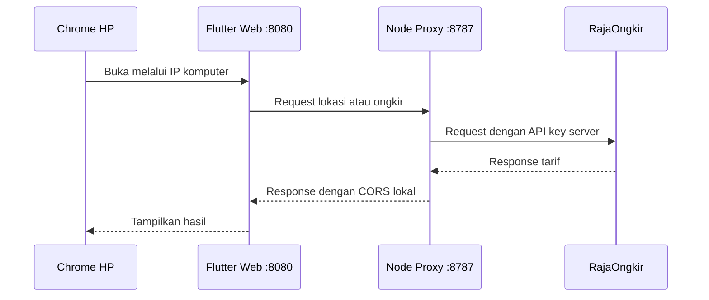
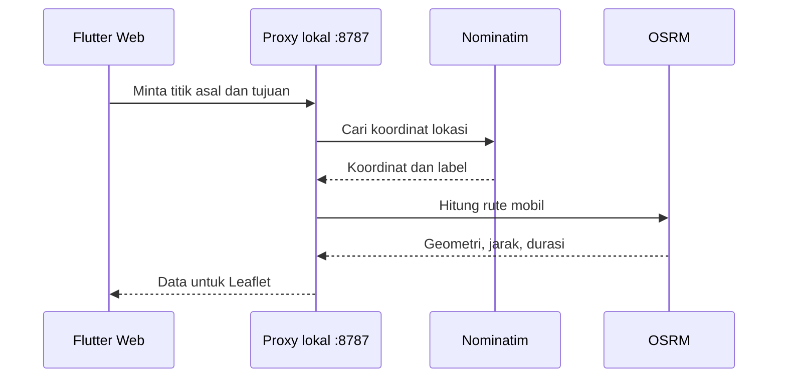

# 📦 Ongkirin

Kalkulator ongkos kirim domestik Indonesia berbasis Flutter, RajaOngkir, Leaflet, dan OpenStreetMap. Ongkirin membantu pengguna memilih lokasi, memasukkan berat paket, membandingkan kurir, dan melihat gambaran rute dalam satu alur yang ringkas.


> 🚚 **Cek cepat. Bandingkan jelas. Pilih layanan yang paling masuk akal.**

## ✨ Pengalaman utama

| Langkah | Yang dilakukan | Hasil di layar |
| --- | --- | --- |
| 📍 Lokasi | Cari asal dan tujuan atau gunakan lokasi saat ini | Ringkasan rute yang mudah dibaca |
| ⚖️ Paket | Masukkan berat atau gunakan tombol tambah cepat | Berat otomatis tersinkron dengan form |
| 🚚 Kurir | Pilih satu kurir atau bandingkan semua | Layanan tersedia dikumpulkan dalam satu hasil |
| 🧭 Rute | Buka pratinjau Leaflet atau Google Maps | Garis rute, jarak, dan estimasi perjalanan |
| 💡 Pilihan | Gunakan filter semua, termurah, atau tercepat | Kartu hasil mengikuti konteks filter aktif |


## 🧩 Fitur

- Pencarian asal dan tujuan melalui data RajaOngkir
- Pemakaian lokasi saat ini sebagai saran asal dengan fallback manual
- Tombol tukar asal dan tujuan
- Tombol tambah berat `+250 g`, `+500 g`, `+1 kg`, dan `+2 kg`
- Pilihan kurir tunggal atau semua kurir yang tersedia
- Filter hasil `Semua hasil`, `Termurah`, dan `Tercepat`
- Badge hasil yang mengikuti filter aktif
- Rekomendasi tujuan terakhir yang disimpan secara lokal
- Pratinjau rute Leaflet dengan OpenStreetMap dan OSRM
- Tombol membuka rute lanjutan di Google Maps
- Loading, validasi, empty state, timeout, unauthorized, proxy error, dan server error state
- Proxy Node lokal untuk mengatasi CORS pada Flutter Web
- API key RajaOngkir hanya dibaca dari server proxy

## 🏗️ Arsitektur Web



### Jalur data rute



## 🚀 Menjalankan secara lokal

### 1. Siapkan API key RajaOngkir

Buat file `proxy/.env` secara lokal. File ini sudah masuk `.gitignore`.

```env
RAJAONGKIR_API_KEY=isi_api_key_rajaongkir
PORT=8787
```

### 2. Jalankan proxy

```powershell
cd proxy
node server.mjs
```

### 3. Jalankan preview Web cepat

Buka terminal kedua dari root project.

```powershell
.\tool\serve-web-fast.ps1
```

Setelah tidak ada perubahan kode Flutter, gunakan cache build.

```powershell
.\tool\serve-web-fast.ps1 -SkipBuild
```

Untuk menguji dari HP, komputer dan HP harus tersambung ke Wi-Fi yang sama. Buka alamat berikut di Chrome HP.

```text
http://192.168.1.5:8080
```

Jangan memakai `localhost` atau `127.0.0.1` dari HP.

### Debug Web dengan hot reload

```powershell
flutter pub get
flutter run -d web-server --web-hostname 0.0.0.0 --web-port 8080
```

Proxy tetap harus berjalan di terminal lain.

```powershell
node proxy\server.mjs
```

## 🗺️ Pratinjau rute tanpa API key

Halaman hasil memakai Leaflet untuk tampilan peta, OpenStreetMap untuk tile, Nominatim untuk mencari titik lokasi, dan OSRM untuk menghitung rute mobil. Layanan tersebut dipanggil melalui proxy lokal dan tidak membutuhkan Google Maps API key. Peta menyertakan atribusi OpenStreetMap. Tombol `Buka rute di Google Maps` tetap tersedia untuk navigasi lanjutan.

## 🧯 Membaca status error

| Pesan | Arti | Langkah cepat |
| --- | --- | --- |
| `Proxy tidak bisa menghubungi RajaOngkir` | Proxy atau koneksi internet bermasalah | Pastikan terminal proxy aktif |
| `API key tidak valid` | Kredensial RajaOngkir ditolak | Periksa `proxy/.env` |
| `Kurir atau parameter pengiriman tidak valid` | Kombinasi kota, berat, atau kurir ditolak | Pilih kurir spesifik atau cek input |
| `Layanan RajaOngkir sedang bermasalah (HTTP ...)` | Server upstream mengembalikan error | Coba lagi setelah beberapa saat |

## 🧪 Pemeriksaan kode

```powershell
dart analyze lib test
flutter test --no-pub
node --check proxy/server.mjs
```

Sloth dapat menjalankan pemeriksaan yang sama melalui:

```powershell
.\tool\check.ps1
```

## 🔐 Keamanan API key

- API key Web hanya dibaca dari `proxy/.env`.
- `proxy/.env` sudah diabaikan oleh Git.
- Jangan menaruh API key di `lib/`, `web/`, README, screenshot, log, atau prompt.
- Jika key pernah terlihat di screenshot atau chat, revoke lalu buat key baru.

## 📌 Status pengembangan

Ongkirin sedang dikembangkan dengan fokus pada pengalaman mobile, koneksi Web melalui proxy, pencarian lokasi, pratinjau rute, perbandingan kurir, dan filter keputusan yang mudah dipahami.

## 📄 Lisensi dan kontribusi

Project ini dikembangkan untuk kebutuhan pembelajaran dan pengembangan aplikasi. Perubahan sebaiknya melewati analyzer, test yang relevan, dan pengujian melalui entry point aplikasi sebelum digabungkan.
