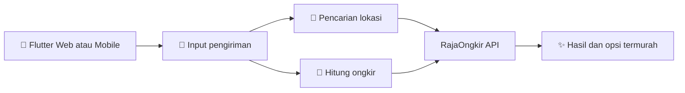
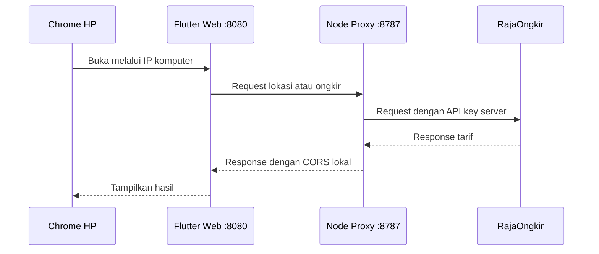

# Ongkirin 📦

Kalkulator ongkos kirim domestik Indonesia berbasis Flutter dan RajaOngkir. Ongkirin membantu pengguna memilih lokasi, memasukkan berat paket, membandingkan kurir, lalu melihat estimasi biaya dan waktu pengiriman dari satu alur yang ringkas.


## ✨ Fitur

- Pemilihan asal dan tujuan melalui pencarian lokasi RajaOngkir
- Tombol tukar asal dan tujuan
- Preset berat `250 g`, `500 g`, `1 kg`, dan `2 kg`
- Pilihan kurir dan perhitungan estimasi biaya
- Ringkasan pengiriman yang berubah mengikuti input
- Penanda opsi termurah
- Loading, validasi, empty state, timeout, unauthorized, dan server error state
- Proxy Node lokal untuk mengatasi CORS pada Flutter Web
- API key Web disimpan di server proxy, bukan di bundle browser
- Tombol lokasi otomatis dengan fallback pencarian manual
- Rekomendasi tujuan terakhir yang disimpan lokal

## 🧭 Alur aplikasi



## 🏗️ Arsitektur Web



## 🚀 Menjalankan secara lokal

### 1. Siapkan API key di proxy

Buat file `proxy/.env` secara lokal. File ini tidak boleh di-commit.

```env
RAJAONGKIR_API_KEY=isi_api_key_rajaongkir
PORT=8787
```

### 2. Jalankan proxy

```powershell
cd proxy
node server.mjs
```

### 3. Jalankan Flutter Web

Buka terminal kedua dari root project.

```powershell
flutter pub get
flutter run -d web-server --web-hostname 0.0.0.0 --web-port 8080
```

### Preview Web lebih cepat

Untuk preview yang lebih ringan setelah build release pertama, gunakan terminal kedua:

```powershell
.\tool\serve-web-fast.ps1
```

Setelah tidak ada perubahan pada kode Flutter, jalankan server tanpa build ulang:

```powershell
.\tool\serve-web-fast.ps1 -SkipBuild
```

Proxy tetap harus berjalan di terminal lain:

```powershell
node proxy\server.mjs
```

Untuk menguji dari HP, komputer dan HP harus tersambung ke Wi-Fi yang sama. Buka alamat berikut di Chrome HP dengan IP komputer.

```text
http://IP_KOMPUTER:8080
```

Contoh:

```text
http://192.168.1.5:8080
```

Jangan memakai `localhost` atau `127.0.0.1` dari HP.

Browser dapat membatasi geolocation pada alamat HTTP lokal. Jika Chrome meminta HTTPS atau menolak izin lokasi, gunakan pencarian asal manual. Proxy dan kalkulator tetap dapat dipakai tanpa fitur lokasi otomatis.

## 🧪 Pemeriksaan kode

```powershell
dart analyze lib test
flutter test --no-pub
node --check proxy/server.mjs
```

Sloth dapat menjalankan pemeriksaan yang sama melalui:

```powershell
.\tool\check.ps1
```

Jika `flutter test` perlu mengunduh package dan jaringan sedang bermasalah, jalankan ulang setelah koneksi ke `pub.dev` tersedia.

## 🔐 Keamanan API key

- API key Web hanya dibaca dari `proxy/.env`.
- `proxy/.env` sudah diabaikan oleh Git.
- Jangan menaruh API key di `lib/`, `web/`, README, screenshot, log, atau prompt.
- Jika key pernah terlihat di screenshot atau chat, revoke dan buat key baru.

## 🛠️ Status pengembangan

Ongkirin sedang dikembangkan bertahap dengan fokus pada pengalaman mobile, koneksi Web melalui proxy, lokasi otomatis, riwayat tujuan, dan rekomendasi tujuan yang memiliki dasar data yang jelas.

## 📄 Lisensi dan kontribusi

Project ini dikembangkan untuk kebutuhan pembelajaran dan pengembangan aplikasi. Perubahan sebaiknya melewati analyzer, test yang relevan, dan pengujian melalui entry point aplikasi sebelum digabungkan.
