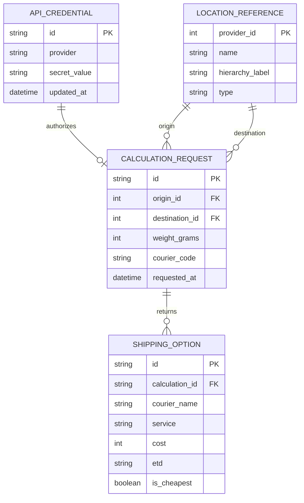

# Entity Relationship and Data Model

MVP tidak memakai database server. ERD ini mendokumentasikan objek lokal, request, dan response agar boundary data tetap jelas.

`API_CREDENTIAL` berada di secure storage. Objek lain bersifat runtime. Riwayat permanen bukan bagian MVP.

